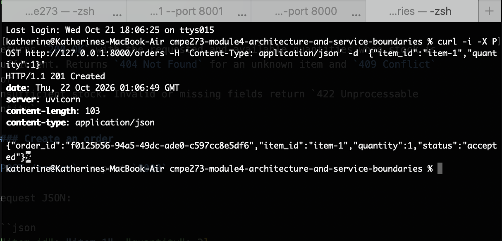
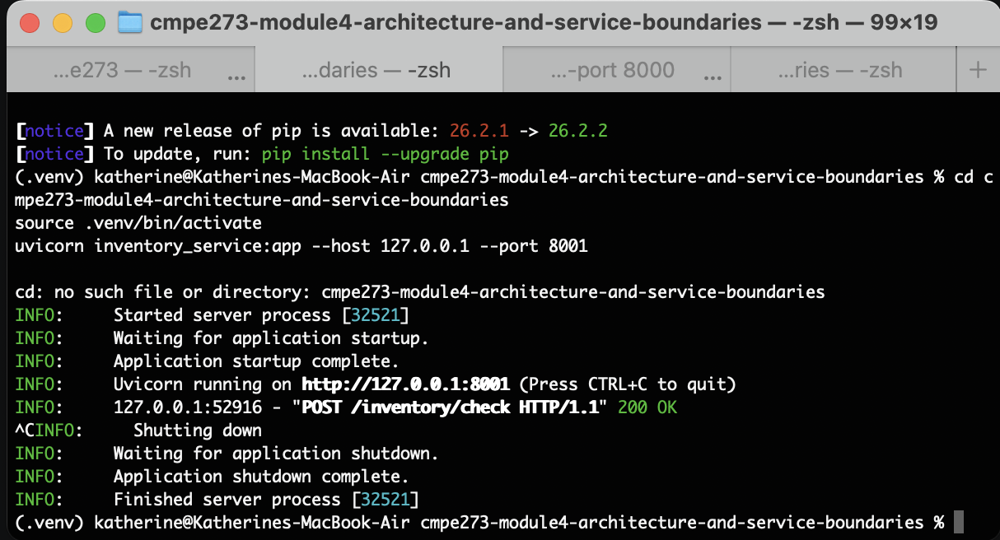
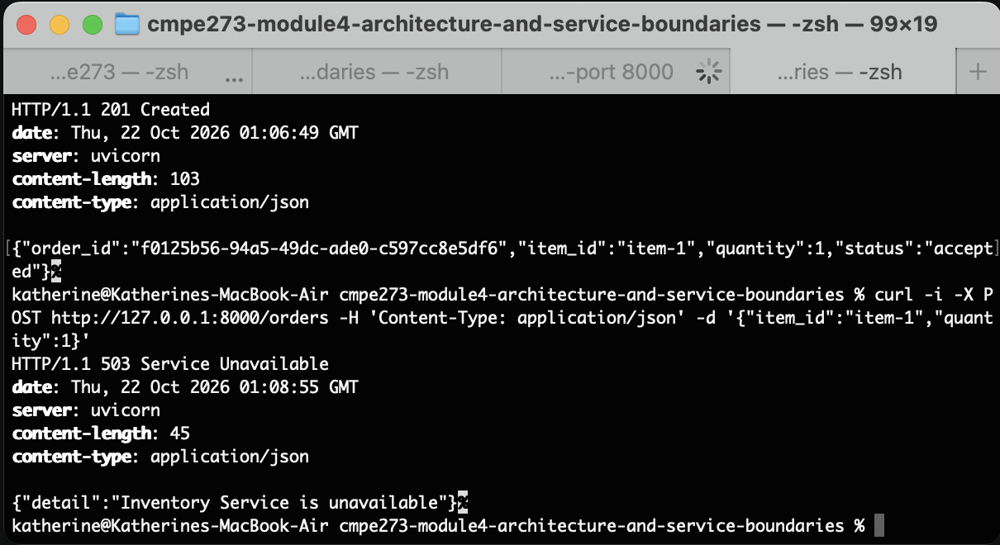

### Setup

From the workspace root, enter the module directory and install dependencies:

```sh
cd cmpe273-module4-architecture-and-service-boundaries
python -m venv .venv
source .venv/bin/activate
pip install -r requirements.txt
```

Open two terminals at the workspace root. In **Terminal 1**, enter the module
directory and start Inventory:

```sh
cd cmpe273-module4-architecture-and-service-boundaries
source .venv/bin/activate
uvicorn inventory_service:app --host 127.0.0.1 --port 8001
```

In **Terminal 2**, start Order:

```sh
cd cmpe273-module4-architecture-and-service-boundaries
source .venv/bin/activate
uvicorn order_service:app --host 127.0.0.1 --port 8000
```

Leave both terminals running and use a third terminal for `curl` requests.

The Order Service defaults to `http://127.0.0.1:8001` for Inventory. Configure
the target with `INVENTORY_SERVICE_URL`; configure the request timeout in
seconds with `INVENTORY_TIMEOUT_SECONDS` (default: `2.0`). Set
`INVENTORY_DELAY_SECONDS` on the Inventory process to delay each check for
timeout demonstrations (default: `0`).

### Endpoints

#### Check inventory

`POST /inventory/check` on port `8001`

Request JSON:

```json
{ "item_id": "item-1", "quantity": 3 }
```

Returns `200 OK` with the requested and available quantities when stock is
sufficient. Returns `404 Not Found` for an unknown item and `409 Conflict` for
insufficient stock. Invalid or missing fields return `422 Unprocessable
Entity`.

#### Create an order

`POST /orders` on port `8000`

Request JSON:

```json
{ "item_id": "item-1", "quantity": 3 }
```

Returns `201 Created` with a generated `order_id` when inventory is sufficient.
The Inventory Service's `404` and `409` responses are propagated. If the
Inventory Service times out, Order returns `504 Gateway Timeout`; if it cannot
be reached, Order returns `503 Service Unavailable`; unexpected upstream
responses return `502 Bad Gateway`. Invalid input returns `422`.

The demo inventory starts with 10 units of `item-1` and 5 units of `item-2`.
It is held in memory and is not decremented when an order is accepted.

### Successful REST request and response

With both REST services running and the Inventory delay disabled, create an
order:

```sh
curl -i -X POST http://127.0.0.1:8000/orders -H 'Content-Type: application/json' -d '{"item_id":"item-1","quantity":3}'
```

Example response (`order_id` is generated per request):

```http
HTTP/1.1 201 Created
content-type: application/json

{"order_id":"<generated-uuid>","item_id":"item-1","quantity":3,"status":"accepted"}
```

### Tests

Run the tests with:

```sh
pytest
```

### Dependency failure test

First confirm the normal flow by submitting an order from a third terminal:

```sh
curl -i -X POST http://127.0.0.1:8000/orders -H 'Content-Type: application/json' -d '{"item_id":"item-1","quantity":1}'
```

Expect `201 Created`. Then, in **Terminal 1 only**, press `Ctrl+C` to stop
Inventory. Do not stop or restart the Order process. Submit the same request
again from the third terminal:

```sh
curl -i -X POST http://127.0.0.1:8000/orders -H 'Content-Type: application/json' -d '{"item_id":"item-1","quantity":1}'
```

Expect `503 Service Unavailable` with
`{"detail":"Inventory Service is unavailable"}`. This confirms Order handles
the missing dependency without exiting. Restart Inventory in Terminal 1 using
the Inventory command above, then retry the request; it should return
`201 Created` without restarting Order. The automated test
`test_order_survives_inventory_connection_failure` checks the same failure,
response, and successful subsequent request.

### Architecture Diagram

Client[User / Client] -->|submit order| Order[Order Service<br/>Creates and tracks orders]
Order -->|check item availability| Inventory[Inventory Service<br/>Tracks item availability]
Inventory -->|available / unavailable| Order
Order -->|order-created notification| Notification[Notification Service<br/>Notifies users when an order is created]

Order coordinates the workflow, checks availability with Inventory before accepting an order, then sends a notification event after creating the order. Each service runs as an independent process.

Example of successful request


Proof of inventory failure test; stopping the inventory service


Inventory stopped, Order still running


### Explanation of each component's responsibility

- **Order Service** — Accepts order requests, asks Inventory to check stock,
  and returns an accepted order with a generated order ID only when the
  requested quantity is available. It coordinates the workflow and handles
  Inventory failures without stopping its own process. In this demo, orders
  are not persisted.
- **Inventory Service** — Owns the item-availability data and answers Order's
  availability checks with the requested and available quantities. It can
  report an unknown item or insufficient stock. In this demo, inventory is
  held in memory and is not decremented after an order.
- **Notification Service** — Represents the component that would notify a
  user after Order creates an order, for example by sending an email or
  publishing an event. It is part of the target architecture only; this demo does not currently implement or run a Notification Service.

### Data ownership

- **Order** owns order records: the order ID, requested item and quantity, and
  order status. The current demo generates an ID and returns the order but does
  not persist these records.
- **Inventory** owns the stock quantity for each item. Order asks Inventory for
  availability; it does not read or modify Inventory's data directly. The
  current demo keeps stock in memory and does not reserve or decrement it.
- **Notification** would own notification delivery state, such as queued,
  sent, or failed notifications, and any delivery-specific configuration.
  This component is conceptual and has no data store in the current demo.

Each service is the source of truth for its own data. Other services use its
API or events rather than accessing its storage directly.

### Service boundary rationale

The boundaries follow business capabilities and data ownership. Order owns the order lifecycle and coordinates the request; Inventory is responsible for the authoritative availability decision; Notification handles user-facing communication after an order is created. This keeps each service's rules and data changes localized, lets the services be deployed independently, and prevents an Inventory outage from crashing Order. The synchronous Inventory check is needed before Order can accept the request. Notification is modeled as a separate, post-creation event so delivery can evolve independently.

### Command, Query, and Event

Check whether an item is available: query; Order asks the Inventory Service to read its owned stock data and return an availability decision.

Create an order: command; the client asks Order to perform the action of
creating an order.

Order was created: event; this communicates that order state changed and can be consumed by Notification. In the current demo, this event flow is described but not implemented.

### Reflection

Clear service boundaries and data ownership are important in a distributed architecture because it keeps components loosely coupled. This helps with keeping partial failures partial, which is crucial to a distributed system. This allows for one part of the system to fail while the rest continues to work as expected. Data ownership is also important in a distributed system because it keeps responsibilities separate to also help partial failures stay separate.
